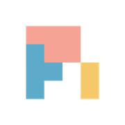

<h1 align="center">
  &nbsp;
  CodeIsland
</h1>

<p align="center">
  <b>Your AI coding agents, live in the MacBook notch.</b><br>
  See which agent is running, which one is blocked on you, and which one just finished — without leaving the window you're in.
</p>

<p align="center">
  <a href="https://github.com/wxtsky/CodeIsland/releases/latest"></a>
  <a href="https://github.com/wxtsky/CodeIsland/releases"></a>
  
  <a href="LICENSE"></a>
  <a href="https://github.com/wxtsky/CodeIsland/stargazers"></a>
</p>

<p align="center">
  <a href="#installation">Install</a> •
  <a href="#highlights">Highlights</a> •
  <a href="#supported-tools">Supported tools</a> •
  <a href="#how-it-works">How it works</a> •
  <a href="#build-from-source">Build</a>
  <br>
  <b>English</b> | <a href="README.zh-CN.md">简体中文</a>
</p>

<p align="center">
  
</p>

## Why CodeIsland?

Coding agents spend a lot of time either working or waiting on you — and you only find out by switching to their window. CodeIsland turns the notch into a live status bar for all of them: which session is running, which one is blocked on an approval or a question, which one just finished. The island only displays: approvals and questions are answered in the agent itself — click once to jump to the exact terminal tab.

> This is a personal, display-only fork: no approvals or question answering on the island, no Buddy companions, no mascot animations, no auto-update.

It works with **30+ AI coding tools**, installs its hooks for you, and keeps everything on your Mac.

## Highlights

<table>
<tr>
<td width="50%" valign="top">

**👀 See everything at a glance**

- Live status, current tool and latest reply for every session; finished replies render as Markdown (lists, tables, code)
- (Opt-in) model + reasoning effort on each session card
- Git branch and worktree on each card
- A static logo per tool, so you can tell harnesses apart at a glance

</td>
<td width="50%" valign="top">

**🚦 Running, blocked, done**

- Every session shows whether it is running, blocked on you (an approval or a question), or finished
- Blocked requests are never held by the island: the agent asks in its own UI, as if CodeIsland were not there
- One click to the exact terminal tab, IDE window, or tmux / zellij / Herdr pane
- Global shortcuts to toggle the island and jump to the terminal

</td>
</tr>
<tr>
<td width="50%" valign="top">

**🧘 Stays out of your way**

- Smart suppress: no ping while you're already looking at that session's tab
- Quiet hours, per-event 8-bit sounds, a "glance dot" completion mode
- Hides in full screen and steps around menu-bar icons
- Silence rules for directories you never want to hear about
- Mutes itself while the screen is locked or asleep; a failed tool call no longer rings the error sound, only a turn that dies does
- Opt-in follow-up reminders for blocked sessions and finished work you haven't looked at yet

</td>
<td width="50%" valign="top">

**🌐 Beyond this Mac**

- SSH remote hosts — server sessions show up next to local ones
- Pushes to your phone or team chat — Bark, ntfy, DingTalk, Lark, WeCom, Slack, Telegram — only while you're away
- Webhook forwarding of raw events for your own automations
- 7 UI languages

</td>
</tr>
</table>


## Supported tools

<table>
<tr>
<td align="center" width="16%"><br><sub><b>Claude Code</b></sub></td>
<td align="center" width="16%"><br><sub><b>Codex</b></sub></td>
<td align="center" width="16%"><br><sub><b>Gemini CLI</b></sub></td>
<td align="center" width="16%"><br><sub><b>Cursor</b></sub></td>
<td align="center" width="16%"><br><sub><b>Grok CLI</b></sub></td>
<td align="center" width="16%"><br><sub><b>OpenCode</b></sub></td>
</tr>
<tr>
<td align="center"><br><sub><b>Qoder</b></sub></td>
<td align="center"><br><sub><b>Trae</b></sub></td>
<td align="center"><br><sub><b>Copilot CLI</b></sub></td>
<td align="center"><br><sub><b>Factory Droid</b></sub></td>
<td align="center"><br><sub><b>CodeBuddy</b></sub></td>
<td align="center"><br><sub><b>Qwen Code</b></sub></td>
</tr>
<tr>
<td align="center"><br><sub><b>Kimi Code CLI</b></sub></td>
<td align="center"><br><sub><b>Cline</b></sub></td>
<td align="center"><br><sub><b>Pi / Oh My Pi</b></sub></td>
<td align="center"><br><sub><b>Hermes</b></sub></td>
<td align="center"><br><sub><b>OpenClaw</b></sub></td>
<td align="center"><br><sub><b>Google Antigravity</b></sub></td>
</tr>
<tr>
<td align="center"><br><sub><b>Kiro CLI</b></sub></td>
<td align="center"><br><sub><b>StepFun</b></sub></td>
<td align="center"><br><sub><b>WorkBuddy</b></sub></td>
<td align="center"><br><sub><b>MiniMax Code CLI</b></sub></td>
<td align="center"><br><sub><b>DeepSeek Harness</b></sub></td>
<td align="center"><br><sub><b>AiWork</b></sub></td>
</tr>
<tr>
<td align="center"><br><sub><b>MiMo Code /<br>Xiaomi MiMo</b></sub></td>
<td align="center"><sub><b>+ more</b><br>see below ↓</sub></td>
</tr>
</table>

**Also covered:** Trae CN, Trae CLI / Trae CLI Next, Qoder CN, Qoder App, QoderWork and Qoder CLI, Cursor CLI, CodeBuddy CN, Claude Desktop (Code tab, and [Cowork](#cowork)), ZCode — plus any tool with Claude-style hooks, added as a **custom CLI** in Settings → Hooks.

**Several accounts?** Register extra Claude Code, Codex and Grok config directories (e.g. a second `CLAUDE_CONFIG_DIR`) in **Settings → Hooks**; each gets its own hooks and status, and sessions, transcripts and usage cover all of them.

**Knows where it runs:** sessions inside **tmux**, **zellij**, **Herdr** or **T3 Code** get a chip next to the terminal badge, and click-to-jump goes to the right pane or thread.

**Approvals & questions** are shown, never answered: a session waiting on a permission prompt or a question is marked as blocked, and you answer it in the agent's own UI.

<details>
<summary><b>Where each integration is installed</b></summary>

<br>

CodeIsland writes these for you on launch (and repairs them if they drift); each can be switched off in **Settings → Hooks**.

| Tool | Installed into |
|------|----------------|
| Claude Code | plugin at `~/.claude/skills/codeisland/` — needs 2.1.157+ (honours `$CLAUDE_CONFIG_DIR`) |
| Codex | `~/.codex/hooks.json` — [needs a one-time review](#codex) |
| Gemini CLI | `~/.gemini/settings.json` |
| Google Antigravity | `~/.gemini/config/hooks.json` |
| Cursor / Cursor CLI | `~/.cursor/hooks.json` |
| Grok CLI | `~/.grok/hooks/codeisland.json` |
| Qoder (IDE and Qoder App) / Qoder CN / QoderWork | `~/.qoder/`, `~/.qoder-cn/`, `~/.qoderwork/` `settings.json` |
| Trae / Trae CN | `~/.trae/hooks.json`, `~/.trae-cn/hooks.json` (turn on global hooks in Trae) |
| Trae CLI / Trae CLI Next | `~/.trae/traecli.yaml`, `~/.trae/cli/hooks.json` |
| Factory, CodeBuddy, StepFun, WorkBuddy, Qwen Code | `~/.<tool>/settings.json` |
| Copilot CLI | `~/.copilot/hooks/codeisland.json` |
| Kimi Code CLI | `~/.kimi-code/config.toml` (or legacy `~/.kimi/`) |
| Kiro CLI | `~/.kiro/agents/codeisland.json` — launch with `kiro --agent codeisland` |
| Hermes | `~/.hermes/config.yaml` — [approve the hooks once](#hermes) |
| ZCode | `~/.zcode/cli/config.json` |
| MiniMax Code CLI | plugin at `~/.minimax/plugins/codeisland/` (honours `$MINIMAX_DATA_DIR`) |
| Cline | `~/Documents/Cline/Hooks` |
| OpenCode | plugin at `~/.config/opencode/plugins/codeisland.js` |
| MiMo Code / Xiaomi MiMo | plugin at `~/.config/mimocode/plugins/codeisland.js` — [see below](#mimo) |
| Pi / Oh My Pi | extension at `~/.pi/agent/extensions/pi-codeisland/` / `~/.omp/agent/extensions/codeisland.ts` |
| OpenClaw | plugin at `~/.openclaw/codeisland-plugin/` |
| DeepSeek Harness | [dsh-island](https://github.com/cdxiaodong/dsh-island) plugin — see [below](#deepseek-harness) |
| AiWork | nothing to install — read from AiWork's local daemon |

</details>

## Installation

This fork ships no prebuilt releases and never updates itself. Build it from source (see [Build from source](#build-from-source)) and copy `.build/release/CodeIsland.app` into Applications; hooks are installed automatically for every AI tool it detects on launch.

## Setup notes

<a name="codex"></a>
<details>
<summary><b>Codex — trust the hooks once</b></summary>

<br>

Codex won't run a hook it hasn't been shown. After installing, Codex prints `1 hook needs review before it can run.` — run `/hooks`, review the CodeIsland entries and trust them. Until you do, Codex silently ignores them, which looks exactly like CodeIsland not supporting Codex. Codex stores a hash per trusted hook in `~/.codex/config.toml` under `[hooks.state]`, so if a CodeIsland update rewrites `~/.codex/hooks.json`, review them once more.

Codex Auto Review stays with Codex. When a turn runs under Auto Review, its permission requests are decided by Codex's reviewer, so the session is not shown as blocked. It takes the turn's reviewer from the session's local rollout (`turn_context`), so a choice made in the Codex desktop permission menu counts, and falls back to `approvals_reviewer` in `config.toml`.

While a Codex turn runs, the collapsed bar shows the agent's latest public output when no tool is active. Hidden reasoning, encrypted content, tool results and internal subagent messages are never displayed.

</details>

<details>
<summary><b>OpenCode 1.x and 2</b></summary>

<br>

A single JS plugin talks to the socket directly — no bridge binary. The same file serves OpenCode 1.x (`server()`) and OpenCode 2 (`setup()`); OpenCode 2 auto-loads it from `~/.config/opencode/plugins/`. Under OpenCode 2's shared background service, click-to-jump reaches the terminal app but not the exact tab, and questions are answered through the service's local HTTP API.

</details>

<a name="mimo"></a>
<details>
<summary><b>MiMo Code and Xiaomi MiMo desktop</b></summary>

<br>

MiMo Code is an OpenCode 1.x fork, and the Xiaomi MiMo desktop app runs it as its engine, so both load the OpenCode plugin from `~/.config/mimocode/plugins/` — CodeIsland writes it there labelled as MiMo and leaves `mimocode.json` alone. MiMo reads plugins when its engine starts, so restart the app (or `mimo`) once after the plugin is installed. Approvals and questions can be answered on the island or in MiMo, whichever comes first. Clicking a desktop session brings Xiaomi MiMo to the front; the app's `xiaomi-mimo://` links only join shared sessions, so there is no way to open one specific conversation.

</details>

<a name="hermes"></a>
<details>
<summary><b>Hermes — approve the hooks once</b></summary>

<br>

Hermes asks before it runs a hook it hasn't seen, once per hook. The next time you start `hermes` in a terminal, answer `y` to each CodeIsland entry (`codeisland-bridge --source hermes`; on an SSH host, the `codeisland-remote-hook.py` ones). Hermes running without a terminal — the gateway service, the desktop app — can't ask, so it skips a hook nobody approved, which looks like CodeIsland not seeing those sessions. Approve them in a terminal once (the approval is kept per Hermes home, so it covers the gateway and the desktop app too), or set `hooks_auto_accept: true` in `~/.hermes/config.yaml`. A CodeIsland update that adds a hook asks again for the new one.

Gateway chats (Telegram, Discord, Slack, WhatsApp, email and the rest, and the API server) get cards too, but they don't pop a completion card or play a sound, and an idle one goes after 10 minutes. A card goes when its session ends: `/new`, quitting `hermes`, closing a desktop conversation, or the gateway shutting down. Session titles are read from Hermes's own `state.db`, read-only.

</details>

<a name="deepseek-harness"></a>
<details>
<summary><b>DeepSeek Harness</b></summary>

<br>

DSH is plugin-native, so CodeIsland installs nothing. The [dsh-island](https://github.com/cdxiaodong/dsh-island) plugin listens to DSH's built-in events and writes them to CodeIsland's socket:

```bash
dsh plugin --profile <profile> add github:cdxiaodong/dsh-island
```

</details>

<details>
<summary><b>Google Antigravity</b></summary>

<br>

Antigravity's `PreToolUse` hook can refuse a tool call but can't approve one, so the island *observes* Antigravity: it shows the running tool and hands every decision straight back to Antigravity's own permission prompt, so your grants and "Always Allow" keep working.

</details>

<details>
<summary><b>SSH remote hosts</b></summary>

<br>

Add a host in **Settings → Remote**. CodeIsland installs a small helper and the hooks on the server (merged into your existing config, never replacing it), and forwards events back over SSH. An optional working-directory filter keeps other people's sessions off your island on shared machines. If a tool shows `skipped`, the status line says why — usually its config directory doesn't exist on that host yet.

</details>

<a name="cowork"></a>
<details>
<summary><b>Claude Desktop Cowork</b></summary>

<br>

Cowork runs inside Claude Desktop's sandbox, where hooks never fire, so CodeIsland reads the session files Claude Desktop keeps on your Mac instead (`~/Library/Application Support/Claude/local-agent-mode-sessions/`, read-only — nothing is installed or written there). Cowork conversations get a card with their title, live status, the running tool, the latest reply and a completion sound; a pending permission request lights up as waiting. Approvals are still answered in Claude Desktop — click the card to open that conversation. Only sessions active in the last few minutes appear, so old ones never come back as ghost cards. Toggle it under **Settings → Hooks → Claude Desktop**.

</details>

<a name="push"></a>
<details>
<summary><b>Phone & chat pushes</b></summary>

<br>

**Settings → Behavior → Push notifications** sends blocked sessions (the approval or question they wait on, with numbered options), finished turns, turn errors and follow-up reminders to Bark, ntfy, DingTalk, Lark / Feishu, WeCom, Slack or Telegram — several at once, each with its own event choices and a **Send test** button that shows the service's real reply. By default a push only goes out while you're away (screen locked, screen saver, displays asleep, or no keyboard / mouse input for 5 minutes), and subagent turns are never pushed. Commands and messages go through the same credential redaction as the rest of the app. Pushes answer nothing: answer in the agent.

</details>

## How it works

```
AI tool (Claude Code / Codex / Gemini / Cursor / …)
  └─ hook fires ─→ codeisland-bridge (native Swift binary)
                     └─ Unix socket /tmp/codeisland-<uid>.sock
                          └─ CodeIsland updates the notch in real time
                               └─ optional: push, webhook
```

CodeIsland installs lightweight hooks into each tool's own config. When the tool fires an event — session start, tool call, permission request, question, stop — the bridge forwards it as JSON over a local Unix socket, and the island updates instantly. The bridge never waits for a decision: the agent always asks in its own UI.

**Privacy:** events never leave your Mac unless you opt in. CodeIsland makes no network requests unless you turn them on: webhook forwarding to the URL you configure, and pushes to the services you set up.

## Settings

| Page | What's there |
|------|--------------|
| **General** | Language, launch at login, display selection |
| **Behavior** | Smart suppress, completion style, follow-up reminders, session cleanup, silence rules, push notifications, webhook |
| **Appearance** | Panel size, notch width, font size, reply lines, project name, git branch, model label |
| **Sound** | 8-bit sounds per event, volume, quiet hours, mute while away |
| **Shortcuts** | Global hotkeys for toggle and jump |
| **Remote** | SSH hosts and per-host directory filters |
| **Hooks** | Install status per tool, reinstall / uninstall, extra config directories, Claude Desktop Cowork, custom CLIs |
| **About** | Version, this version's release notes, diagnostics export |

### Keyboard shortcuts

| Shortcut | Action | Default |
|----------|--------|---------|
| <kbd>⌘</kbd><kbd>⇧</kbd><kbd>I</kbd> | Toggle the island open / closed | On |

Every shortcut can be rebound in **Settings → Shortcuts**, where you can also bind *jump to terminal*.

## Build from source

Requires **macOS 14+** and **Swift 5.9+**.

```bash
git clone https://github.com/wxtsky/CodeIsland.git
cd CodeIsland

# Development: debug build + launch
swift build && ./.build/debug/CodeIsland

# Release: universal binary (Apple Silicon + Intel)
./build.sh
open .build/release/CodeIsland.app

# Tests
swift test
```

## Requirements

- macOS 14 Sonoma or later
- Best on a MacBook with a notch; external and notch-less displays work too

## Acknowledgments

Inspired by [claude-island](https://github.com/farouqaldori/claude-island) by [@farouqaldori](https://github.com/farouqaldori) — thanks for the original idea of putting AI agent status in the macOS notch. And thanks to everyone who has contributed integrations, fixes and bug reports.

## Star history

<a href="https://star-history.dera.page/#wxtsky/CodeIsland&type=date&legend=bottom-right">
  <picture>
    <source media="(prefers-color-scheme: dark)" srcset="https://star-history.dera.page/svg?repos=wxtsky/CodeIsland&type=date&theme=dark&legend=top-left" />
    <source media="(prefers-color-scheme: light)" srcset="https://star-history.dera.page/svg?repos=wxtsky/CodeIsland&type=date&legend=top-left" />
    
  </picture>
</a>

## License

MIT — see [LICENSE](LICENSE).
